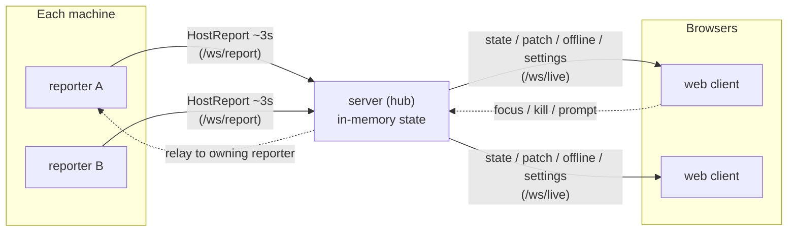
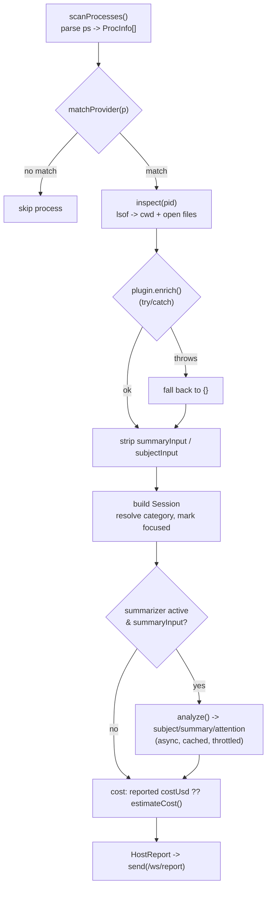
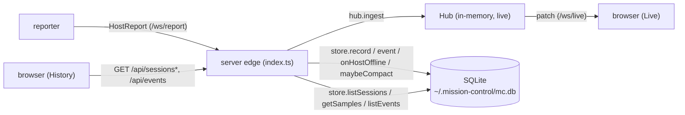
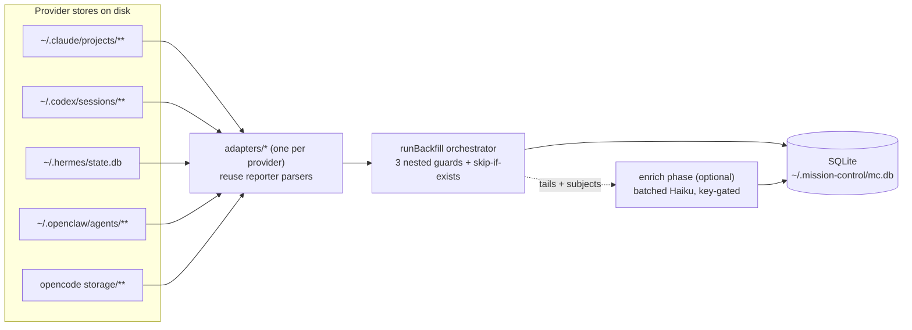
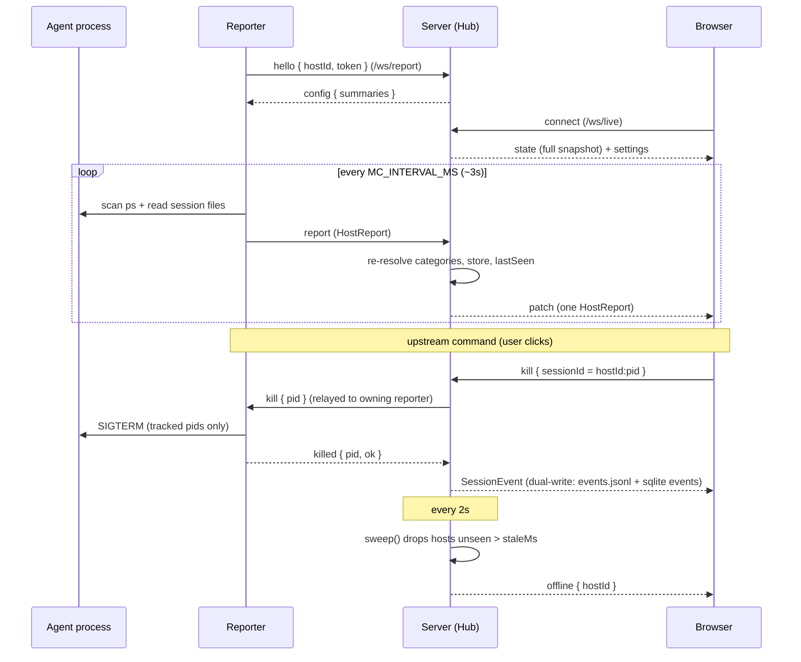

# Architecture

Mission Control is a live dashboard of every **currently-running** AI agent session (Claude Code, Codex, OpenCode, pi, Hermes, OpenClaw) across all your machines. A session appears on the board only while its process is alive and vanishes when the process exits. This document is the architecture orientation; see `README.md` for operational details (deploy, env tables, provider support matrix) and `CLAUDE.md` for working conventions.

## The big picture: a one-way data river



Solid arrows are the downstream river; dashed arrows are the only upstream traffic — control commands the server relays to the originating reporter.

Three processes, four packages. Data flows one direction: reporters observe and push; the server fans out; the browser renders. The only thing that travels upstream is a small set of **control commands** (focus a terminal, kill a process, type a prompt), which the server relays to the originating reporter.

The **live** state lives **only in memory** in the server. A restart loses the live board, which is fine — reporters re-report within a tick (~3s) and the board rebuilds itself. Separately, a durable **persistence sidecar** (SQLite) captures session history, samples, and events at the I/O edge; it is a write-only tap on the river that **does not feed back** into live state (the hub never reads it). See [Persistence layer](#persistence-layer).

Everything runs on **Bun**. TypeScript executes directly via `.ts`/`.tsx` imports (`allowImportingTsExtensions`), so imports carry explicit extensions. There is no bundler config beyond `Bun.build`; `tsc` is `noEmit`, used only for editor/type checks.

## Packages

| Package | Role |
|---------|------|
| `packages/shared` (`@mc/shared`) | The contract: wire types, cost pricing, category resolution |
| `packages/reporter` | Per-machine process scanner + enricher; compiles to a standalone binary |
| `packages/server` | Central in-memory hub + WebSocket transport + static web host |
| `packages/web` | React 19 dashboard |

---

## `packages/shared` — the contract

This package is the schema. Changing anything here ripples through all packages.

### `types.ts` — wire protocols

**`Session`** — one agent process. Identity is a composite `id = ${hostId}:${pid}`, stable across reconnects.

```ts
export type Session = {
  id: string;            // `${hostId}:${pid}`
  provider: string;
  pid: number;
  hostId: string;
  hostLabel: string;
  cwd: string | null;
  category: string;      // resolved role: "code" | "review" | "research" | ...
  startedAt: number;     // epoch ms process start
  cpu: number;           // point-in-time CPU %
  memMb: number;         // resident memory

  // signals
  lastActivityAt?: number;  // last session-file write — fallback "processing" signal
  active?: boolean;         // authoritative "processing now" (only some providers)
  focused?: boolean;        // this session's terminal tab is foreground
  attention?: boolean;      // blocked waiting on the user
  ask?: string;             // what it's waiting for (when attention)
  suggestion?: string;      // a plausible reply (when attention)
  errored?: boolean;        // last turn ended in an API/agent error
  errorTransient?: boolean; // error looks recoverable vs hard failure
  errorAt?: number;         // epoch ms of error, for auto-expiry

  // best-effort enrichment (absent => UI renders "—")
  model?: string;
  subject?: string;         // broad topic, anchored on opening prompts
  summary?: string;         // recent recap of what it's doing now
  tokensIn?: number;
  tokensCacheRead?: number;
  tokensCacheWrite?: number;
  tokensOut?: number;
  toolsUsed?: string[];
  costUsd?: number;
};
```

Two signals are deliberately distinct:
- **`active`** = processing right now.
- **`attention`** = blocked waiting on the user (drives the amber "needs input" flag).

Only providers that expose authoritative state set them (e.g. Claude reads `status` from `~/.claude/sessions/<pid>.json`). Absent authoritative state, the web falls back to a `lastActivityAt` heuristic.

**`HostReport`** — a snapshot of all sessions on one host at a moment:

```ts
export type HostReport = { hostId: string; hostLabel: string; sentAt: number; sessions: Session[] };
```

**`ReporterMsg`** (reporter → server): `hello` (token-auth handshake), `report` (a HostReport), `ping` (heartbeat), `killed`/`prompted` (command confirmations).

**Server → reporter**: `focus`, `kill`, `prompt` (commands to act on a pid), `config` (push summaries config).

**Browser → server**: `focus`, `kill`, `prompt` requests, plus `set-settings`.

**`LiveMsg`** (server → browser): `state` (full snapshot on subscribe), `patch` (single updated HostReport), `offline` (a host went away), `settings` (current `AppConfig`).

**`AppConfig`** — server-side persisted config: `staleMs`, `categories` (serializable category rules), and `summaries` (`enabled`, `model`, `minIntervalMs`).

### Agent aliases, prompt interception, and A2A routing

Mission Control will act as the registry and router for live agent sessions. The routing identity is a server-assigned handle, not the PID:

```ts
type AgentAlias = {
  handle: `mc:a${number}`;       // mc:a1, mc:a2, ...
  sessionId: string;             // existing `${hostId}:${pid}`
  generation: string;            // `${hostId}:${pid}:${startedAt}` metadata
  providerSessionId?: string;    // provider-native id when discoverable
  displayName?: string;          // Haiku-generated one-word label
};
```

Rules:
- Handles use the `mc:a<n>` form (`mc:a1`, `mc:a2`, ...). The `mc:` namespace avoids CLI-flag ambiguity (`-c1`) and makes handles easy to recognize in prompts, logs, and events.
- Handles are assigned by the server for a live `sessionId` (`hostId:pid`) and stay sticky for that PID. The generation value is still tracked as metadata, but it does not drive the visible `mc:a<n>` number.
- The display name is generated by Haiku from the session's subject/summary context. It must be very short, meaningful, exactly one word, and contain no dashes. It is a UI aid only; routing never depends on it.
- Alias state belongs in the server/hub layer because the server already has the full cross-host view. Reporters continue to report processes and execute commands by PID.
- Provider-native session ids are optional but preferred. Claude and Codex can expose them today. Terminal prompt interception requires an identifiable source session so replies can return safely; cwd fallback is allowed only when it resolves to exactly one live provider session.

The near-term agent-to-agent path is a provider-agnostic router backed by the existing prompt relay:

```text
source agent -> MCP tool or prompt hook -> Mission Control /api/intercept or /api/ask
Mission Control -> reporter prompt { pid, text, commandId } -> target terminal session
target agent -> MCP tool reply_to_agent(taskId, text), or completion hook -> Mission Control
```

Prompt interception is not Codex-specific. Any provider adapter that can observe a user prompt should call `POST /api/intercept` with `{ provider, providerSessionId?, cwd?, prompt }`. Mission Control parses a deliberately small alias grammar:

- `ask mc:a3 what service x does`
- `tell mc:a3 check the failing test`
- `ping mc:a3`
- `mc:a3 summarize your current task`

When the prompt matches, Mission Control creates a routed task and sends the target agent a prompt. Hook adapters block alias prompts by default after interception so the source agent does not answer on behalf of the target. Set `MC_ALIAS_INTERCEPT_MODE=context` to opt back into non-blocking annotation mode for a provider/event where blocking is unsafe.

Providers that expose a completion/stop event can also call `POST /api/complete` with `{ provider, providerSessionId?, cwd?, text }`. Mission Control treats that as the target's answer for its latest open routed task and relays it back to the source agent.

The long-term interoperability goal is an A2A adapter for Mission Control. A2A is the right external protocol because the target abstraction is another autonomous agent: discovery through Agent Cards, task identity, multi-turn context, status, cancellation, and artifacts. MCP remains the right way to expose local tools to an agent, including a Mission Control router tool, but MCP alone does not model peer-agent collaboration. Mission Control should therefore expose live sessions as routable agent endpoints while preserving the current reporter model underneath.

### `cost.ts` — longest-prefix pricing

A `PRICE_TABLE` maps model-name prefixes to USD-per-1M-token `{ in, out }` rates (claude-fable/opus/sonnet/haiku, gpt-5/gpt-4, o3). `priceFor(model)` picks the **longest matching prefix**, so `claude-opus-4-8-20250101` resolves to the `claude-opus` row without needing the exact version in the table.

Cache tokens bill at adjusted rates:
- `CACHE_READ_FACTOR = 0.1` — cache reads at 10% of fresh input.
- `CACHE_WRITE_FACTOR = 1.25` — cache writes at 125% of fresh input.

```
costUsd = (tokensIn·in + tokensCacheRead·in·0.1 + tokensCacheWrite·in·1.25 + tokensOut·out) / 1e6
```

Rounded to 4 decimals. Returns `undefined` when the model is unknown.

### `category.ts` — role resolution

A session's role is resolved with fixed precedence (first match wins):

1. **`byCwd`** — ordered regex rules against the session's cwd.
2. **`byProvider`** — provider id → category.
3. **provider default** — from the provider plugin.
4. **fallback** — `"uncategorized"`.

Wire form (`SerializableCategoryConfig`) stores `byCwd.match` as a string pattern; the server compiles it to a `RegExp` at ingest. Crucially, categories are **re-resolved on every ingest**, so editing rules in the UI takes effect on the next reporter tick without a restart.

---

## `packages/reporter` — observe and push

Runs on each machine. Scans `ps` every `MC_INTERVAL_MS` (default 3000ms), matches processes to providers, enriches them from per-agent session files, optionally summarizes with Haiku, and pushes a `HostReport`. Compiles to a standalone binary (`bun build --compile`) for drop-on-host deployment.

Side effects (fs, sockets, `ps`, `lsof`, AppleScript) live at the edges; parsing and assembly are pure functions so the core stays unit-testable.

### Flow: `procscan.ts` → `collect.ts` → `providers/*`




**`procscan.ts`** (pure parsing):
- `parsePs(stdout)` parses `ps -axo pid=,ppid=,etime=,pcpu=,rss=,tty=,comm=,args=` into `ProcInfo[]`. `parseEtime` handles BSD `DD-HH:MM:SS` formats. `rss` (KB) → `memMb`.
- `inspectProc(pid)` shells `lsof -p <pid> -Fftn` and `parseLsof` extracts `cwd` plus open regular files. Fails silently to `{ cwd: null, openFiles: [] }`.

**`collect.ts`** (orchestration) — for each process:
1. `matchProvider(p)` against the registry; skip if no match.
2. `deps.inspect(p.pid)` for cwd + open files.
3. `startedAt = now - uptimeSec*1000`.
4. **`plugin.enrich()` wrapped in try/catch** — on throw, falls back to `{}`. One unparseable session file can never kill the whole host report. This is a hard contract.
5. Strip `summaryInput` / `subjectInput` from the enrichment — these are ephemeral LLM inputs and **never land on `Session`**.
6. Build the `Session`, resolve its category, mark `focused` if its tty is in the foreground set.
7. If a summarizer is active and `summaryInput` exists, run the recap (see below).
8. Cost: prefer a provider-reported `costUsd`; otherwise `estimateCost()` from the price table.

### The provider plugin model

The most common extension point. A `ProviderPlugin` (`providers/types.ts`):

```ts
export interface ProviderPlugin {
  id: string;
  defaultCategory: string;                 // role when config doesn't override
  matchProcess(p: ProcInfo): boolean;      // is this process mine?
  enrich?(p, cwd, ctx): Promise<Enrichment>; // best-effort; MUST NOT throw to caller
}
```

Registered in `providers/index.ts` as an **ordered** `REGISTRY` — first match wins, so specific plugins precede generic ones. `matchProvider(p)` is a linear scan.

`enrich()` returns an `Enrichment` (a `Partial<Session>` of enrichable fields) plus the two ephemeral fields:
- **`summaryInput`** — recent role-tagged conversation text. Returning it is what **opts a provider into LLM recaps**.
- **`subjectInput`** — the opening user prompts, used for the broad subject.

Enrichment generally maps a process to its session file **by cwd**, picking the *newest* transcript for that project. Consequence: multiple sessions sharing a cwd may report identical totals. Daemons without cwd scoping (Hermes, OpenClaw) use the most-recent session globally.

#### Providers at a glance

| Provider | Match | Data source | Tokens | Cost | Authoritative state |
|----------|-------|-------------|--------|------|---------------------|
| **claude** | `claude` in args / comm | `~/.claude/sessions/<pid>.json` (status) + `~/.claude/projects/<enc-cwd>/<sessionId>.jsonl` | yes (usage) | estimated | yes — `status` → `active`/`attention` |
| **codex** | `codex` | `~/.codex/sessions/.../rollout-*.jsonl` + `~/.mission-control/codex/<sessionId>.json` (hook state) | yes | estimated | yes — via observe-only hook |
| **opencode** | `opencode` | `~/.local/share/opencode/storage/{session,message,part}` | no | estimated | mtime heuristic |
| **openclaw** | `openclaw` | `~/.openclaw/agents/*/sessions/*.jsonl` (newest, cwd-agnostic) | yes (Claude format) | estimated | mtime heuristic |
| **hermes** | `hermes` | `~/.hermes/state.db` (SQLite, newest session) | yes (DB) | estimated | mtime heuristic |
| **pi** | `pi` | `~/.pi/agent/sessions/**/<sessionId>.jsonl` | yes | **reported directly** | mtime heuristic |

Notes:
- **Claude** uses sessionId as the authoritative transcript key (no fallback) to avoid collapsing multiple same-cwd sessions; birthtime-matching is a legacy fallback. It also reuses its transcript parser for **OpenClaw** (same format).
- **Codex** state comes from an observe-only hook (see below); `attention` is always honored, but `active` is only trusted when the hook explicitly set it.
- **Pi** is the only provider that reports its own `costUsd`.

### `focus.ts` — macOS terminal control

Detects which terminal tabs are foreground (`focusedTtys()` via AppleScript against iTerm2/Terminal) and powers the upstream commands: `focusPid()` selects and activates the owning tab, `sendText()` types a prompt into the session, `killPid()` sends SIGTERM (only to PIDs the reporter currently tracks). Terminal app is resolved by walking the process ancestry. Non-macOS hosts simply skip these.

### Summaries (Haiku) — best-effort, async, never blocking

When `ANTHROPIC_API_KEY` is set and summaries are enabled, `summarizer.ts` generates one-line recaps with Claude Haiku **in the background**.

- `Summarizer.analyze(sessionId, recent, subject)` is **synchronous and non-blocking**: it returns immediately with the cached result and an `{ fresh }` flag.
- Cached per session by a content hash of `(recent + subject)`. A hash hit returns `fresh: true`.
- Throttled by `minIntervalMs` (default 60s) and an in-flight guard; while throttled it returns the stale result with `fresh: false` and schedules a background refresh.
- The generator uses Haiku's structured JSON-schema output to return `{ subject, summary, awaitingUser, ask, suggestion }`.

`collect.ts` only sets `attention = true` when `awaitingUser && fresh && !errored && active !== true` — the `fresh` flag prevents a stale "awaiting" from a prior turn lingering after the agent moves on. Without the API key (or `MC_SUMMARIES=0`), everything else works unchanged. **Core reporting never depends on summaries.**

### Reporter main loop (`index.ts`)

Connects to `MC_SERVER_URL` (default `ws://localhost:7777/ws/report`), sends `hello` with `{ hostId, hostLabel, token }`, then ticks every `intervalMs`: `scanProcesses()` → `collect()` → `send({ type: "report", report })`. It tracks known PIDs (kill safety), handles incoming `focus`/`kill`/`prompt`/`config` commands, and auto-reconnects 2s after any disconnect.

Key env vars: `MC_SERVER_URL`, `MC_TOKEN`, `MC_HOST_ID`, `MC_HOST_LABEL`, `MC_HOME`, `MC_INTERVAL_MS`, `MC_SUMMARIES`, `MC_SUMMARY_MODEL`, `MC_SUMMARY_INTERVAL_MS`, `ANTHROPIC_API_KEY`.

---

## `packages/server` — the hub

`index.ts` is a thin `Bun.serve` transport; `hub.ts` is the transport-agnostic state machine. All real logic (ingest, broadcast, stale-sweep) lives in the hub so it unit-tests without real sockets. Keep that separation.

### `hub.ts` — in-memory state

```ts
private hosts   = new Map<hostId, HostReport>();
private lastSeen = new Map<hostId, number>();
private sinks    = new Set<LiveSink>();   // browser subscribers
```

- `subscribe(sink)` — adds a browser, immediately sends the full `state`, returns an unsub fn.
- `ingest(report, now)` — recompiles category rules, **re-resolves every session's category**, stores the report, updates `lastSeen`, and broadcasts a `patch` (not a full state).
- `touch(hostId, now)` — heartbeat from a `ping`, refreshes `lastSeen` without a new report.
- `sweep(now)` — drops any host unseen for longer than `staleMs`.
- `dropHost(hostId)` — removes the host and broadcasts `offline`.
- `broadcastSettings(config)` — pushes `settings` to all browsers.

### `index.ts` — transport

`Bun.serve` exposes three WebSocket endpoints plus static hosting of the built web bundle (with SPA fallback to `index.html`):

- **`/ws/report`** (reporter → server): token-authed via the `hello` handshake (mismatch → `ws.close(4001)`). Registers the reporter socket by `hostId`, ingests `report`s, `touch`es on `ping`, and on `killed`/`prompted` publishes a durable `SessionEvent`.
- **`/ws/live`** (server → browser): on connect, subscribes the socket (full `state`) then sends `settings`. Handles `set-settings` (validate → persist → re-resolve/re-broadcast as needed) and relays `focus`/`kill`/`prompt` to the owning reporter by parsing `sessionId` into `hostId:pid`.
- **`/ws/events`**: append-only lifecycle stream (`session.killed`, `session.prompted`), also written durably to `~/.mission-control/events.jsonl` **and** inserted into the persistence store's `events` table (dual-write — see [Persistence layer](#persistence-layer)).

The same `index.ts` edge also drives the persistence store: `store.record(report, now)` runs right after `hub.ingest`, `store.onHostOffline` runs on a clean socket-close and on stale-sweep, `store.maybeCompact` runs on the 2s timer, and lifecycle/A2A events are dual-written via `store.event`. Every store call is wrapped in try/catch — a persistence failure must never break live reporting (mirrors the `publishEvent` best-effort contract). Read-only `GET /api/sessions*` / `/api/events` requests are served here too.

A timer runs `hub.sweep(Date.now())` every 2s. Config is loaded from `~/.mission-control/config.json` and re-persisted on UI changes.

### `config.ts`

`defaultConfig(env)` seeds from `MC_STALE_MS`, `MC_SUMMARIES`, `MC_SUMMARY_MODEL`, `MC_SUMMARY_INTERVAL_MS`, plus the retention block (`MC_SAMPLE_INTERVAL_MS`, `MC_RETAIN_RAW_DAYS`, `MC_RETAIN_HOUR_DAYS`, `MC_RETAIN_EVENT_DAYS`, `MC_RETAIN_MAX_BYTES`, `MC_COMPACT_INTERVAL_MS`). `mergeConfig`/`applySettings` overlay a UI patch and clamp `staleMs` to a 2s floor. Editing the retention block live calls `store.setRetention`, so the new policy applies on the next sample/compaction without a restart.

---

## Persistence layer

The live river is intentionally amnesiac, but `packages/server/src/store.ts` adds a durable **capture sidecar** so closed sessions, cost/token history, and lifecycle events survive a restart. It is constructed at the `index.ts` I/O edge — `hub.ts` stays pure/in-memory — and is a one-directional tap: the store is written from the edge but **never read back into live state**.



### The `Store` module

A `Store` class wraps a single `bun:sqlite` `Database` (WAL mode) and owns all persistence reads and writes. The DB path comes from `MC_DB` (`:memory:` in tests) else `~/.mission-control/mc.db`. Pure helpers (`sessionKeyOf`, `condenseSamples`, `hourBucket`, `dayBucket`) are exported and unit-tested without a DB; everything stateful is a method on the class.

Every call from the server edge is **best-effort**: `index.ts` wraps `record`, `event`, `onHostOffline`, `maybeCompact`, and `setRetention` in try/catch so one bad write degrades to lost history, never a broken live board.

### Capture flow

- **`record(report, now)`** — called after `hub.ingest`. In one transaction it (1) upserts every live session into the `sessions` registry, marking it `running`, merging rollups (max peak-context, union of tools); (2) diffs the report against the **previous tick for that host** (`prevByHost`) to emit lifecycle events — `session.started` for new keys, `session.state` on `active`/`attention` flips, `session.errored` on error flips, `session.tool` for newly-seen tools, and `session.closed` for keys that vanished (also setting `state='closed'`, `ended_at`); (3) runs a **per-session sample gate** — at most one `raw` sample per `sampleIntervalMs`.
- **`onHostOffline(hostId, now)`** — a whole host disconnected or went stale. Its still-`running` rows are marked `orphaned` (distinct from `closed`: `ended_at` stays NULL because the processes may still be alive — we just can't see them). The host's `prevByHost` snapshot is dropped so a returning reporter re-registers its sessions as `started` rather than diffing against a stale tick; the upsert revives the rows to `running`.
- **`compact(now)` / `maybeCompact(now)`** — `maybeCompact` is throttled to `compactIntervalMs`; `compact` does the tiered downsampling (below). Registry rows are never touched by compaction.

### Three-table schema

| Table | Role | Key columns |
|-------|------|-------------|
| `sessions` | Registry — one row per session, kept forever | `session_key` (PK), `live_id` (last `hostId:pid`), `resume_id`, `provider`, `host_id`/`host_label`, `cwd`, `category`, `model`, `handle`, `display_name`, `subject`, `started_at`, `ended_at`, `state` (`running`/`closed`/`orphaned`), `last_seen_at`, rollups: `cost_usd`, `tokens_*`, `peak_context_tokens`, `tools_used` (JSON) |
| `samples` | Per-session time-series | PK `(session_key, at, resolution)`; `resolution` ∈ `raw`/`hour`/`day`; `tokens_*`, `cost_usd` (cumulative), `context_tokens`/`cpu`/`mem_mb` (gauges), `context_window`, `active` (0/1 raw → duty-cycle fraction once condensed) |
| `events` | Discrete events | `id` (autoinc PK), `at`, `session_key`, `type`, `host_id`, `pid`, `detail` (JSON) |

The durable **`session_key`** is the provider-native session id when available, else a synthetic `${hostId}:${pid}:${startedAt}` — stable across reconnects and PID recycling, which is why it (not the live `hostId:pid`) is the registry key.

`PersistedEventType` is a superset of the live `SessionEvent` discriminants: `session.started`, `session.closed`, `session.state`, `session.tool`, `session.errored`, `session.killed`, `session.prompted`, `task.routed`, `task.replied`.

### Retention: an age ladder + a size ceiling

Samples are downsampled as they age and events are aged out, on the cadence of `maybeCompact`:

1. **raw → hour** — raw samples older than `rawDays` are grouped by UTC-hour bucket and condensed into one `hour` row each. Cumulative fields (cost, token counters) take the **last** value in the bucket; gauges (`context_tokens`, `cpu`, `mem_mb`) are averaged; `active` becomes the duty-cycle fraction.
2. **hour → day** — `hour` samples older than `hourDays` are condensed the same way into `day` buckets.
3. **events** — rows older than `eventDays` are hard-deleted.
4. **size ceiling** — while the DB exceeds `maxBytes`, the oldest still-`raw` hour-bucket is promoted early, preempting the age ladder. (Under WAL `page_count` does not shrink mid-loop, so under genuine size pressure this drains all raw rows down to hour resolution rather than hitting a precise byte target — a safe degradation: data is downsampled, not lost.)

Retention is a `RetentionConfig` (`sampleIntervalMs`, `rawDays`, `hourDays`, `eventDays`, `maxBytes`, `compactIntervalMs`), seeded from env in `config.ts`, editable live in the Settings panel via `store.setRetention`.

### Dual-write transition (jsonl + sqlite)

Lifecycle and A2A events are written to **both** sinks this round: the existing `~/.mission-control/events.jsonl` append-log (live `/ws/events` consumers) **and** the sqlite `events` table (history queries). The jsonl was intentionally **not removed** — it is a transition state, and a future follow-up may consolidate onto the sqlite table.

### Read API

Read-only JSON GET endpoints, served from the same edge with the same public trust model as `/ws/live` (gate behind auth before exposing on an untrusted network):

- `GET /api/sessions` — registry rows, newest-first; filters `state`/`provider`/`category`/`cwd`/`since`/`until`/`limit`/`offset` (limit/offset clamped at the parse layer).
- `GET /api/sessions/:key` — one registry row plus its recent events. `:key` is URL-encoded (it may contain colons). 404 if unknown.
- `GET /api/sessions/:key/samples` — time-series for the session, ASC by `at`; `since`/`until`/`resolution` (`raw`/`hour`/`day`/`auto`, auto picks a tier from the span).
- `GET /api/events` — events newest-first; filters `type`/`sessionKey`/`since`/`until`/`limit`.

### Backfill — seeding history from on-disk transcripts

The live server only persists sessions it observes while running. The **backfill**
CLI (`scripts/backfill.ts`, `bun run backfill`) is a separate, one-shot process
that imports **historical** sessions already on disk into the same `Store` (and
the same `~/.mission-control/mc.db`, `MC_DB` to override). It does **not** touch
or require the live server — it constructs its own `Store` and writes through the
same `importSession` / `applyEnrichment` surface.



**Adapter model.** `packages/server/src/backfill/adapters/{claude,codex,hermes,openclaw,opencode}.ts`
is one isolated adapter per provider, registered in `backfill/index.ts`'s
`REGISTRY`. Each `available()`-gates on its store existing, `discover()`s raw
sessions, derives a stable `sessionKey()`, and `toImport()`s a closed
`PersistedSession` + samples + events. Adapters **reuse the reporter's
`providers/*` parsers** (e.g. `parseCodexRollout`, `assembleHermes`,
`assembleOpencode`, the Claude transcript parser for OpenClaw) for tokens / model
/ subject / recap text — no duplicate parsing — and layer on backfill specifics
(timestamps, cwd, source→category, resume ids). Shared boilerplate
(`buildClosedSession`, `pointsToSamples`, `trimTail`) lives in
`backfill/adapters/_common.ts`.

**Three guards (graceful degradation).** `runBackfill` nests try/catch so nothing
sinks the whole run:
- **provider guard** — a throwing `discover()`/loop isolates that adapter
  (`failed=true`) and the run continues with the next.
- **session guard** — a throwing `toImport()`/`sessionKey()` for one item is
  tallied as `skipped` (with a reason) and the loop continues.
- **field guard** — best-effort cost estimation and category resolution are each
  wrapped so a bad value degrades to null/the adapter's own value, never a throw.

The end-of-run `BackfillReport` tallies imported / skipped / failed per provider.

**Skip-if-exists idempotency.** Before writing, `store.has(key)` short-circuits an
already-present key (`skipped`) — **live/running rows always win** and are never
clobbered, so re-running only imports genuinely new sessions.

**Hour-only samples.** Adapters with per-turn timestamps (claude/codex/openclaw/
opencode) emit only `resolution: "hour"` sample rows via `pointsToSamples`
(no `raw` tier — backfilled history starts already condensed). Hermes has no
per-turn time-series, so it imports a registry row with no samples.

**Optional enrich phase.** `backfill/enrich.ts` runs a second pass
(`enrichMissing`) that fills `summary` / `subject` / `attention` / `ask` /
`suggestion` for rows still missing a recap, using **batched Haiku**
(`anthropicBatchAnalyze`, one `messages.create` per batch of `--batch-size`,
id-keyed structured output so reordered/short responses are safe). It is
**key-gated** (no-op without `ANTHROPIC_API_KEY`), re-runnable (`--enrich-only`
re-imports nothing and only fills `WHERE summary IS NULL`), and degrade-safe (a
row with no captured tail, or a batch that throws twice, is counted `degraded`,
never fatal). `--no-enrich` skips it entirely.

---

## `packages/web` — the dashboard (React 19)

### `useLive.ts` — connection + state reducer

Single source of truth in the browser. Opens a WS to `…/ws/live` and reduces `LiveMsg` into a `Map<hostId, HostReport>`:
- `state` → clear and repopulate.
- `patch` → set one host.
- `offline` → delete one host.
- `settings` → store `AppConfig`.

Exposes connection status (`connecting`/`online`/`offline`), the config, and command senders `focus`/`kill`/`prompt`/`setSettings`. Auto-reconnects every 2s.

### `App.tsx` — grid

Renders sessions as `SessionCard`s, grouped/sorted with a fixed status ranking: persistent error > transient error > needs attention > active > idle. Within a rank, sorted by the active pref (activity / cost / started). A free-text search matches across provider, model, subject, tools, etc.; hidden categories/providers/hosts are filtered out. Cards show live status dots (error / needs-input / active / focused), stats, tool chips, and a prompt input (Tab accepts the suggestion; send is disabled while the session is active). Killing a session goes through a confirmation modal.

### `History.tsx` + `useHistory.ts` — the persistence view

A top-level **Live / History** toggle (`ViewTabs`) switches the dashboard between the live grid and the persistence view. The two are mutually exclusive by design: `LiveBoard` (which calls `useLive`) is only mounted in the Live view, so switching to History tears down the WS subscription, and `History` is lazy-loaded — its module and `useHistory`'s `fetch`es only run when first opened. History reads the [read API](#read-api) (not the WebSocket): it lists `closed`/`orphaned` sessions with metric sparklines (from `/api/sessions/:key/samples`), an event timeline (`/api/sessions/:key`), and a one-click **resume-command copy** button built from `resumeCommand(session)` (`@mc/shared`) — disabled when the session has no `resumeId`.

### `Settings.tsx` + `prefs.ts`

A slide-over panel with two tiers of settings:
- **View prefs** (client-only, persisted to `localStorage` under `mc.prefs`): theme (auto/light/dark), sort, density, show cost/tokens, and the hidden-X filters.
- **Server config** (round-tripped via `set-settings`): stale timeout, summaries (enabled/model/interval), and the editable `byProvider` / `byCwd` category rules.

### Build

`packages/web/build.ts` runs `Bun.build` from `src/index.html`, minifies, and emits to `dist/`, which the server serves. The web bundle is **not** hot-reloaded in `bun run dev` — rebuild with `bun run build:web` after web changes.

---

## End-to-end lifecycle



## Scripts, hooks, and tooling

- **`scripts/dev.ts`** (`bun run dev`) — spawns server and a local reporter together with `--watch`.
- **Build** — `bun run build:web` (required before the server can serve the UI); `bun run build:reporter` compiles the single binary to `dist/mc-reporter`.
- **`scripts/install-codex-hook.ts`** + **`hooks/mc-codex-attention.sh`** — the Codex adapter. It writes live state for the reporter (`attention` on `PermissionRequest`, `active` on turn/tool events), delegates `UserPromptSubmit` payloads to the generic `hooks/mc-agent-prompt-hook.ts` adapter, and delegates `Stop` payloads so the target's final answer can route back through `/api/complete`. Alias prompts are blocked by default after interception; set `MC_ALIAS_INTERCEPT_MODE=context` to make them annotation-only.
- **`scripts/install-claude-hook.ts`** — the Claude Code adapter installer. It additively registers the generic `hooks/mc-agent-prompt-hook.ts` adapter for `UserPromptSubmit` and `Stop` in `~/.claude/settings.json`, preserving existing hooks and backing up before writes.

## Testing conventions

Tests are `*.test.ts` colocated with source and pure-function-first: `parsePs`, `parseEtime`, cost/category math, transcript parsers, and the `Hub` are all tested without I/O. New logic should follow — keep side-effects at the edges so the core stays testable.

```bash
bun test                                          # everything
bun test packages/reporter/src/reporter.test.ts   # one file
bun test -t "longest-prefix"                       # one test by name
```

## Design rules worth remembering

1. **One-way river.** Reporters never read server state; the server never reaches into reporters except to relay a command. State is memory-only and self-healing.
2. **`enrich()` must never throw.** `collect.ts` guards it; a bad session file degrades one session, not the host report.
3. **Ephemeral LLM inputs never persist.** `summaryInput`/`subjectInput` are stripped before storage.
4. **Summaries are best-effort.** Core reporting works with no API key.
5. **The shared package is the schema.** Wire types, pricing, and category precedence are the contract every other package depends on.
6. **Keep the hub transport-agnostic.** Logic in `hub.ts`, sockets in `index.ts`.
7. **Aliases are handles, display names are labels.** Route by `mc:a<n>` and session generation; use Haiku names only for human scanability.
8. **A2A is the external agent protocol goal.** Use MCP to give agents access to the router, but use A2A semantics for durable agent-to-agent tasks.
9. **Persistence is a best-effort edge sidecar.** The `Store` is wired in `index.ts`, never `hub.ts`; all calls are try/catch-guarded so lost history never breaks the live board, and the store is never read back into live state.
